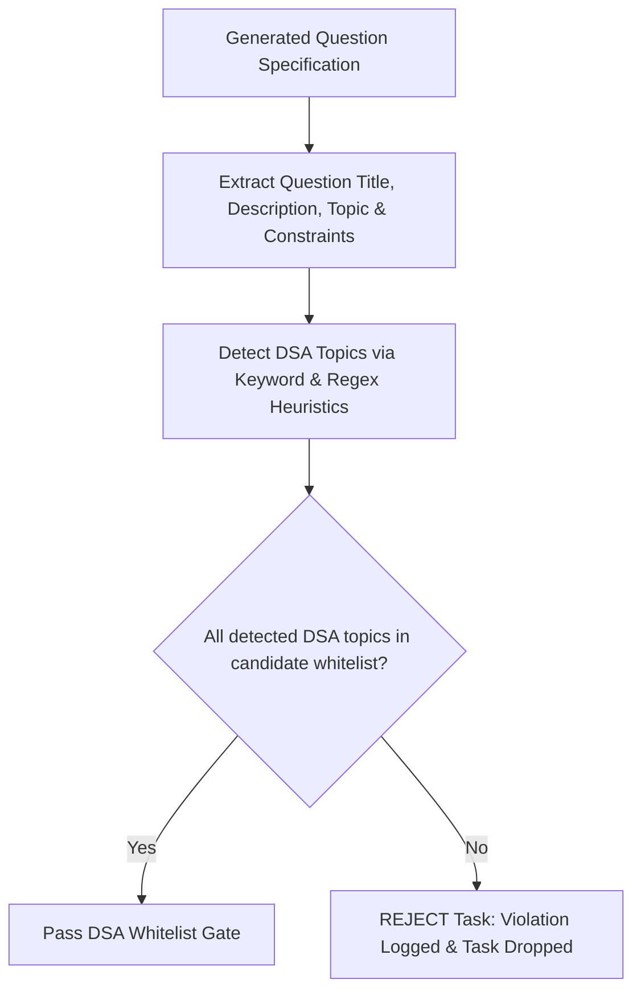
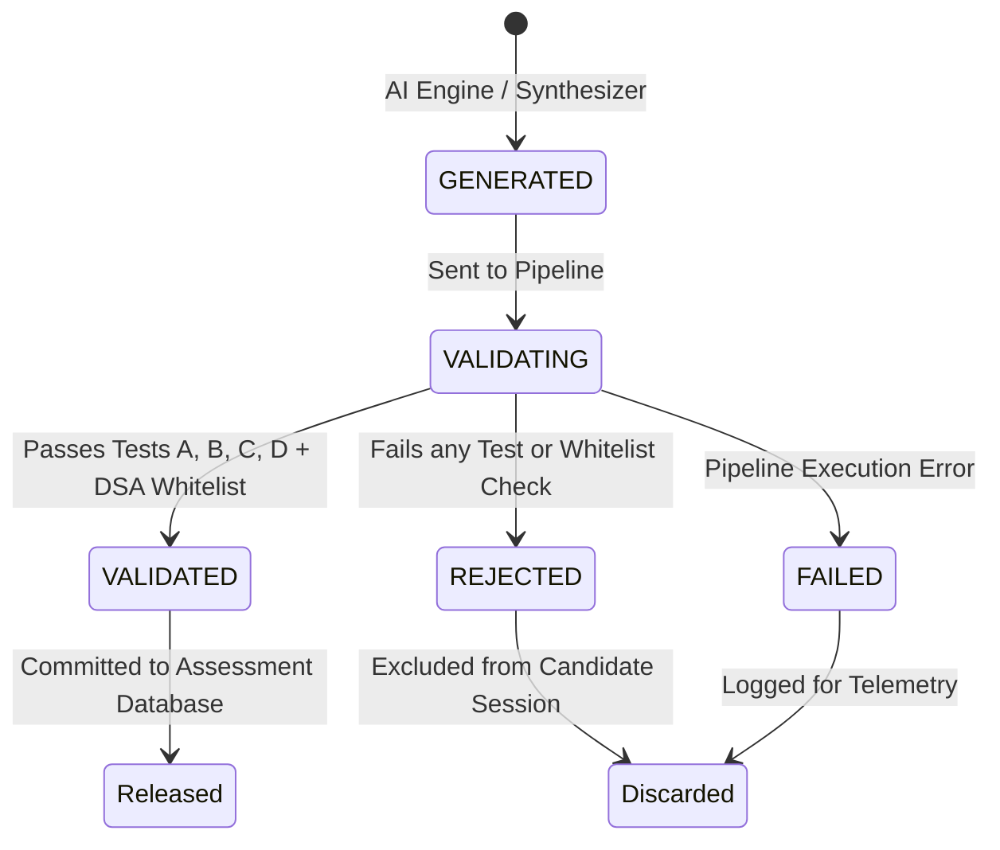

# VERITY — Adaptive Assessment Generation & Task Validation Pipeline

**Team:** Gate code (`HFT26-TEAM-75`)  
**Project:** Portfolio-Driven Adaptive Coding & Technical Assessment Platform

---

## 1. Portfolio Intake & Metadata Grounding

Personalized assessment generation begins with verified portfolio intake (`POST /api/portfolio/upload`):

```json
{
  "github_url": "https://github.com/candidate/portfolio-repo",
  "primary_languages": ["python", "cpp"],
  "frameworks": ["fastapi", "docker"],
  "dsa_topics_solved": ["Arrays", "Strings", "Hash Tables", "Two Pointers"],
  "preferred_domain": "Backend Distributed Systems",
  "projects": [
    {
      "title": "Distributed Cache",
      "description": "Implemented LRU memory cache with TTL eviction.",
      "technologies": ["Python", "Redis"]
    }
  ]
}
```

The system ingests and validates these fields, mapping candidate skills and projects to prompt templates for AI question generation.

---

## 2. Strict DSA Whitelisting & Boundary Enforcement

A critical security principle of VERITY is **Zero-Trust DSA Whitelisting**:
- Candidates are evaluated **strictly** on the DSA topics they claim to have solved.
- If a candidate claims `["Arrays", "Strings", "Hash Tables"]`, the system **prohibits** generating questions that require advanced data structures such as `Graphs`, `Trees`, `Dynamic Programming`, `Tries`, or `Heaps`.

### Canonical DSA Taxonomy (18 Topics)
1. Arrays
2. Strings
3. Linked Lists
4. Stacks
5. Queues
6. Hash Tables
7. Trees
8. Heaps
9. Graphs
10. Dynamic Programming
11. Greedy Algorithms
12. Backtracking
13. Bit Manipulation
14. Tries
15. Sliding Window
16. Two Pointers
17. Binary Search
18. Sorting

### Whitelist Verification Flow


---

## 3. Four-Part Automated Task Validation Pipeline (Tests A–D)

Before any AI-generated question is committed to the database or released to a candidate, it must pass all 4 automated tests:

### Test A: Reference Solution Verification
- **Module:** `backend/app/validation/reference_validator.py`
- **Criterion:** The AI-generated reference solution is compiled and executed in the sandbox against **100% of public and hidden test cases**.
- **Rule:** If any test fails, times out, or triggers an error, the task is immediately marked `REJECTED`.

### Test B: Starter Code Solvability Check
- **Module:** `backend/app/validation/test_validator.py`
- **Criterion:** The starter code template is executed against the test suite.
- **Rule:** The starter code **must fail at least one meaningful acceptance test**. If starter code passes 100% of test cases, the task is trivially pre-solved and marked `REJECTED`.

### Test C: Test Suite Quality & Uniqueness
- **Module:** `backend/app/validation/test_validator.py`
- **Criteria:**
  - Minimum 1 public example and minimum 1 hidden test case.
  - Zero blank or whitespace-only expected outputs.
  - Distinct test case inputs (no duplicates).

### Test D: Static Security & Operation Check
- **Module:** `backend/app/validation/question_validator.py`
- **Criterion:** AST and regex security scanning of starter code and reference solution.
- **Forbidden Constructs:** `os.system`, `subprocess.run`, `pty`, `socket`, `urllib`, `open('/etc/...')`, `/var/run/docker.sock`.

---

## 4. Task Lifecycle States

Each candidate task progresses through formal state transitions:



---

## 5. Fallback Synthesizer for High Availability

If the external Featherless AI API is unreachable or times out, the platform seamlessly activates `generate_portfolio_calibrated_fallback`:
- Generates 100% deterministic, valid, grounded questions based on the candidate's verified languages and claimed DSA topics.
- Subject to the identical four-part validation pipeline (Tests A–D).
- Guarantees zero downtime during live hackathon demonstrations or recruiter assessments.
