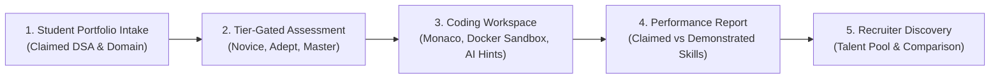

# VERITY — Hackathon Live Judging & Demonstration Guide

**Team:** Gate code (`HFT26-TEAM-75`)  
**Project:** Portfolio-Driven Adaptive Coding & Technical Assessment Platform

---

## 1. Demo Walkthrough Overview

This guide provides a rapid 5-minute live demonstration flow showcasing the complete end-to-end functionality of VERITY for hackathon judges and reviewers.



---

## 2. Step-by-Step Live Demo Script

### Step 1: Candidate Portfolio Intake
1. **Navigate to:** `http://localhost:5173/auth/register` (or register as a new student).
2. **Upload Portfolio:** Provide GitHub URL (`https://github.com/candidate/portfolio`), select Primary Languages (`Python`, `C++`), preferred domain (`Backend Systems`), and select solved DSA topics (`Arrays`, `Strings`, `Hash Tables`).
3. **Observation:** The system extracts and displays the canonical DSA taxonomy tags and creates version `1.0` of the candidate's portfolio.

### Step 2: Tier Selection & Assessment Generation
1. **Choose Assessment Tier:**
   - **Novice / Easy (60 min):** Localized bug fix. DSA whitelisted to claimed topics. Notice that the **AI Assistant is disabled**.
   - **Adept / Medium (60 min):** Multi-step problem. Guarded AI Assistant enabled.
   - **Master / Hard (60 min):** High-concurrency or performance-constrained systems problem.
2. **Click "Generate Personalized Assessment":**
   - The zero-trust pipeline runs Tests A, B, C, D in the background.
   - If Featherless AI is offline, the fail-safe synthesizer immediately yields a validated assessment.

### Step 3: Coding Workspace & Sandboxed Execution
1. **Monaco Editor Experience:** Observe syntax highlighting, responsive starter code, and test case panels.
2. **Run Public Tests:**
   - Click **Run Tests**.
   - The code executes inside an isolated Docker container (`--network none`, non-root, `--read-only`).
   - Results display exact stdout comparison and test verdicts (`AC`, `WA`, `TLE`).
3. **Guarded AI Hint Experience (Adept/Master Tier):**
   - Request **Hint 1:** Conceptual guidance is provided without solution code.
   - Request **Hint 2:** Strategy and data structure pointers.
   - Request **Hint 3:** Implementation nudge.
   - Notice: Full solution code and hidden test cases are strictly redacted.
4. **Novice Tier AI Disabled Check:**
   - Switch to an Easy/Novice tier assessment.
   - Notice the AI Hint panel is disabled and calling the hint API returns HTTP `403 Forbidden`.

### Step 4: Final Submission & Performance Report
1. **Submit Assessment:** Click **Submit Final Solution**.
2. **Review Detailed Report:**
   - **Composite Score:** Computed using the $80/20$ formula ($80\%$ Coding + $20\%$ AI Efficiency). For Novice tier, score is $100\%$ technical.
   - **Skill Observations:** Observe categorized breakdown of **Claimed Skills** vs **Demonstrated Skills** (verified by passing tests) vs **Unassessed Skills**.
   - **Outcome:** Displays **PASS** (score $\ge 80$) or **NEEDS_IMPROVEMENT**.

### Step 5: Recruiter Portal & Talent Comparison
1. **Log in as Company / Recruiter:** `http://localhost:5173/auth/company/login`.
2. **Search Talent Pool:**
   - Filter by **Programming Language** (`Python`), **Domain** (`Backend Systems`), **Coding Score** ($\ge 80$), and **AI Efficiency** ($\ge 90$).
3. **Candidate Comparison:**
   - Select 2 to 4 candidates from the search results.
   - Click **Compare Candidates**.
   - View side-by-side metric charts, shared skills, and performance deltas.
4. **Shortlist Management:**
   - Add candidates to company shortlist with custom recruiter notes.

---

## 3. Quick Verification Commands for Reviewers

```powershell
# 1. Run all 138 unit and integration tests
python -m pytest backend/tests/ tests/test_hackathon_scenarios.py -v

# 2. Run the 8 Hackathon Scenarios
python -m pytest tests/test_hackathon_scenarios.py -v

# 3. Verify clean frontend build
npm --prefix frontend run build
```
