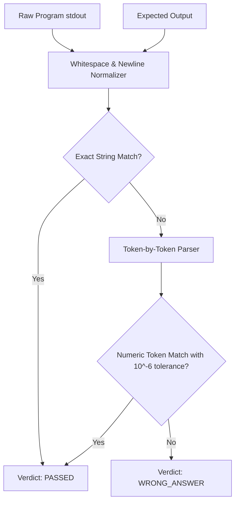

# VERITY — Deterministic Grading & Output Normalization Engine

**Team:** Gate code (`HFT26-TEAM-75`)  
**Project:** Portfolio-Driven Adaptive Coding & Technical Assessment Platform

---

## 1. Zero-LLM Grading Guarantee

A core integrity requirement of the hackathon problem statement is:
> **LLMs must NEVER independently grade candidate code or evaluate test correctness.**

VERITY enforces 100% deterministic, rule-based grading:
1. Candidate source code is executed inside the Docker sandbox against pre-compiled test suites.
2. The standard output (`stdout`) generated by the execution is deterministically compared against the expected output by `backend/app/execution/comparator.py`.
3. Test pass/fail verdicts, execution latencies, and memory consumption are computed mathematically without LLM involvement.

---

## 2. Test Suite Architecture: Public vs Hidden Tests

| Test Suite Category | Visibility | Purpose | Weight |
|---|---|---|---|
| **Public Examples** (`public_test_cases`) | Visible to candidate in coding workspace. | Allows candidate to verify starter code, debug syntax, and inspect inputs/outputs. | Unweighted / 0.0 towards final score |
| **Hidden Acceptance Tests** (`hidden_test_cases`) | Strictly hidden server-side; stripped from all candidate API responses. | Evaluates edge cases, boundary conditions, performance, and correctness. | 1.0 to 2.0 weighted points |

### Test Confidentiality Guarantee
In `backend/app/validation/question_validator.py`:
```python
def sanitize_question_for_candidate(question: Dict[str, Any]) -> Dict[str, Any]:
    sanitized = dict(question)
    sanitized.pop("hidden_test_cases", None)
    sanitized.pop("reference_solution", None)
    sanitized.pop("raw_prompt", None)
    return sanitized
```
Hidden tests and reference solutions are **never** returned across HTTP APIs.

---

## 3. Output Comparison & Normalization Rules

`backend/app/execution/comparator.py` enforces cross-platform deterministic comparison:



### Normalization Logic
1. **Line Ending Standardization:** Converts `\r\n` (Windows) and `\r` (Mac) to canonical `\n`.
2. **Whitespace Trimming:** Strips trailing whitespace on every line and trims empty leading/trailing newlines.
3. **Numeric Floating-Point Tolerance:**
   $$|a - b| \le 10^{-6}$$
   Allows mathematically equivalent floating-point solutions without precision mismatch penalties.

---

## 4. Execution Verdict Codes

| Verdict Code | Full Meaning | Description |
|---|---|---|
| **AC** | Accepted | Code executed within time and memory limits; 100% of outputs matched. |
| **WA** | Wrong Answer | Code executed cleanly, but one or more outputs differed from expected. |
| **TLE** | Time Limit Exceeded | Process took longer than allocated `time_limit_seconds` (default: 2.0s). |
| **MLE** | Memory Limit Exceeded | Process exceeded allocated RAM ceiling (default: 256MB). |
| **CE** | Compilation / Syntax Error | Code failed language compiler or Python AST syntax parsing. |
| **RTE** | Runtime Error | Process threw unhandled exception or non-zero exit code during execution. |
| **SEC** | Security Violation | Code triggered pre-execution security or sandbox capability violation. |
