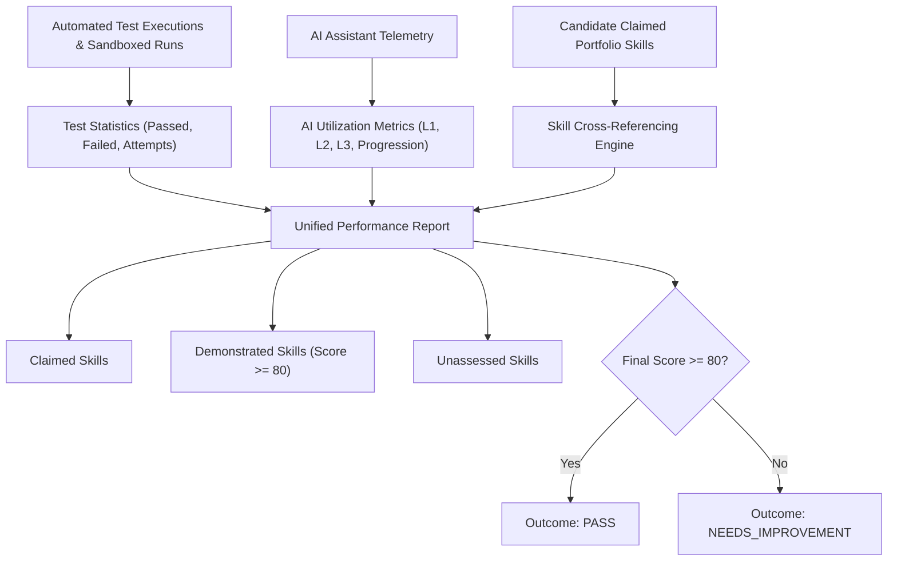

# VERITY — Evidence-Based Performance Report & Skill Observations

**Team:** Gate code (`HFT26-TEAM-75`)  
**Project:** Portfolio-Driven Adaptive Coding & Technical Assessment Platform

---

## 1. Overview of Performance Reporting

VERITY replaces generic scorecards with **Evidence-Based Technical Performance Reports** (`GET /api/analytics/results/{assessment_id}`).

Every metric in the report is grounded in deterministic test case execution, concrete submission history, and cross-referenced portfolio claims.



---

## 2. Report Schema & Data Structure

```json
{
  "success": true,
  "assessment_id": "assess_9b2e1a4c",
  "candidate_name": "Katherine Johnson",
  "domain": "Aerospace & Systems",
  "tier": "adept",
  "duration_minutes": 60,
  "time_taken_seconds": 2415.0,
  "outcome": "PASS",
  "coding_score": 92.5,
  "ai_efficiency_score": 96.0,
  "final_score": 93.2,
  "formula_version": "v1.0",
  "formula_description": "Final Score = 80% Coding Score + 20% AI Efficiency Score (v1.0)",
  "questions_count": 3,
  "questions_passed": 3,
  "correct_test_cases": 12,
  "failed_test_cases": 1,
  "total_test_cases": 13,
  "ai_metrics": {
    "hints_requested": 1,
    "hint_levels_used": [1],
    "productive_hints": 1,
    "progress_after_hints": true,
    "testing_frequency": 4
  },
  "claimed_skills": ["Python", "C++", "Trajectory Optimization", "Docker", "FastAPI"],
  "demonstrated_skills": ["Trajectory Optimization", "Arrays", "FastAPI"],
  "unassessed_skills": ["Docker", "C++"],
  "question_performance": [
    {
      "question_id": "q1",
      "title": "Kepler Orbit Calculation",
      "difficulty": "medium",
      "domain": "Aerospace & Systems",
      "dsa_topic": "Trajectory Optimization",
      "score": 100.0,
      "verdict": "AC",
      "passed": true,
      "passed_tests": 4,
      "failed_tests": 0,
      "total_tests": 4,
      "pass_percentage": 100.0,
      "submission_attempts": 2,
      "hints_used": 1,
      "max_hint_level": 1
    }
  ]
}
```

---

## 3. Skill Observation Categories

1. **Claimed Skills:** All skills, frameworks, and topics imported from the candidate's GitHub portfolio, resume, or profile submission.
2. **Demonstrated Skills:** Skills verified through coding tasks where the candidate achieved a passing score ($\ge 80.0\%$).
3. **Unassessed Skills:** Claimed skills that were not tested in the current assessment session. This prevents false negatives and informs recruiters of unexplored candidate capabilities.

---

## 4. Assessment Outcome Criteria

- **PASS:** Composite final score $\ge 80.0\%$. Indicates strong technical competence, independent problem solving, and effective tool utilization.
- **NEEDS_IMPROVEMENT:** Composite final score $< 80.0\%$. Highlights areas for skill development without ambiguous subjective reviews.
