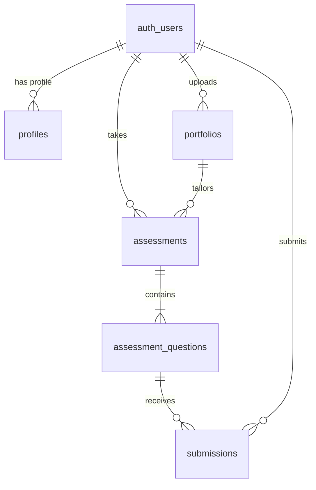

# 📋 Portfolio & Personalized Assessment Milestone Architecture Plan

**Author:** Vasil (Backend, Testing & Execution Lead)  
**Team:** `HFT26-TEAM-75`  
**Feature Branch:** `feature/vasil-portfolio-backend`  
**Target:** `dev`

---

## 1. Executive Summary

This architecture plan outlines the design, security controls, database schema, and frontend/backend API contracts for the **Portfolio Ingestion & Personalized Assessment Engine**.

The milestone bridges candidate portfolio data (skills, GitHub repositories, project experience) with dynamic, adaptive coding assessments generated via **Featherless AI** (`meta-llama/Meta-Llama-3.1-70B-Instruct`) and graded via isolated **Docker sandboxes**.

### Guiding Architectural Principles:
1. **Preserve Supabase Authentication:** Authentication contracts (JWT verification with ES256/HS256, session lifecycle, role guarding) must remain untouched and backward-compatible.
2. **Zero-Trust LLM Generation:** LLM outputs are never trusted blindly. All generated coding tasks must pass strict Pydantic schema validation and the **Question Validation Pipeline** before being stored.
3. **Strict Sandbox Isolation:** Untrusted candidate code is never executed directly on the host FastAPI server. Code execution is delegated to ephemeral, non-networked Docker containers.
4. **Seamless Frontend Coordination:** Concrete TypeScript interfaces and schemas are shared with Zaheed's frontend to prevent contract drift.

---

## 2. Proposed Database Schema

The database design extends Supabase with three core relational tables and one submission table, protected by PostgreSQL Row Level Security (RLS).

Migration file created: [`database/migrations/002_portfolio_and_assessment.sql`](file:///e:/hackathon/HFT26-TEAM-75/database/migrations/002_portfolio_and_assessment.sql)



### 2.1 Table: `public.portfolios`
Stores the candidate's parsed technical portfolio, extracted skill vectors, and project history.

| Column | Type | Constraints | Description |
| :--- | :--- | :--- | :--- |
| `id` | `UUID` | `PRIMARY KEY DEFAULT gen_random_uuid()` | Unique portfolio identifier |
| `user_id` | `UUID` | `REFERENCES auth.users(id) ON DELETE CASCADE` | Owner candidate ID |
| `headline` | `TEXT` | `NULLABLE` | Candidate professional title |
| `bio` | `TEXT` | `NULLABLE` | Short biographical summary |
| `github_username`| `TEXT` | `NULLABLE` | Linked GitHub profile handle |
| `linkedin_url` | `TEXT` | `NULLABLE` | Professional LinkedIn URL |
| `experience_level`| `TEXT`| `CHECK ('beginner', 'intermediate', 'advanced', 'expert')` | Normalized experience tier |
| `raw_json` | `JSONB` | `NOT NULL` | Original submitted JSON document |
| `parsed_skills` | `JSONB` | `NOT NULL DEFAULT '[]'::jsonb` | Categorized skills (languages, frameworks, DBs) |
| `parsed_projects`| `JSONB` | `NOT NULL DEFAULT '[]'::jsonb` | Extracted projects with complexity and stack |
| `recommended_tracks`| `JSONB`| `NOT NULL DEFAULT '[]'::jsonb` | Recommended assessment tracks |
| `created_at` | `TIMESTAMPTZ` | `DEFAULT timezone('utc', now())` | Creation timestamp |
| `updated_at` | `TIMESTAMPTZ` | `DEFAULT timezone('utc', now())` | Last update timestamp |

### 2.2 Table: `public.assessments`
Manages personalized technical assessments tailored to a candidate's portfolio.

| Column | Type | Constraints | Description |
| :--- | :--- | :--- | :--- |
| `id` | `UUID` | `PRIMARY KEY DEFAULT gen_random_uuid()` | Assessment session ID |
| `user_id` | `UUID` | `REFERENCES auth.users(id) ON DELETE CASCADE` | Candidate taking the assessment |
| `portfolio_id` | `UUID` | `REFERENCES public.portfolios(id) ON DELETE SET NULL` | Source portfolio reference |
| `title` | `TEXT` | `NOT NULL` | E.g., "Full-Stack Backend Challenge" |
| `target_role` | `TEXT` | `NOT NULL DEFAULT 'Software Engineer'` | Targeted career track |
| `difficulty` | `TEXT` | `CHECK ('easy', 'medium', 'hard', 'adaptive')` | Assessment difficulty level |
| `status` | `TEXT` | `CHECK ('generating', 'ready', 'in_progress', 'completed', 'expired')` | Lifecycle status |
| `total_time_limit_minutes` | `INT` | `DEFAULT 60` | Timer for assessment completion |
| `metadata` | `JSONB` | `DEFAULT '{}'::jsonb` | LLM model, prompt params, seed |
| `created_at` | `TIMESTAMPTZ` | `DEFAULT timezone('utc', now())` | Generation timestamp |
| `completed_at` | `TIMESTAMPTZ` | `NULLABLE` | Submission completion timestamp |

### 2.3 Table: `public.assessment_questions`
Stores individual coding challenges generated for an assessment.

| Column | Type | Constraints | Description |
| :--- | :--- | :--- | :--- |
| `id` | `UUID` | `PRIMARY KEY DEFAULT gen_random_uuid()` | Question identifier |
| `assessment_id`| `UUID` | `REFERENCES public.assessments(id) ON DELETE CASCADE` | Parent assessment |
| `order_index` | `INT` | `NOT NULL` | Sequence order (1, 2, 3...) |
| `title` | `TEXT` | `NOT NULL` | Problem title |
| `description` | `TEXT` | `NOT NULL` | Markdown problem statement & constraints |
| `difficulty` | `TEXT` | `CHECK ('easy', 'medium', 'hard')` | Individual problem difficulty |
| `category` | `TEXT` | `NOT NULL` | E.g. 'DSA', 'Concurrency', 'Async I/O' |
| `target_skill` | `TEXT` | `NOT NULL` | Specific skill tested (e.g. 'FastAPI') |
| `starter_code` | `JSONB` | `NOT NULL DEFAULT '{}'::jsonb` | Code boilerplates per language |
| `sample_test_cases` | `JSONB` | `NOT NULL DEFAULT '[]'::jsonb` | Public test cases visible to candidate |
| `hidden_test_cases` | `JSONB` | `NOT NULL DEFAULT '[]'::jsonb` | Guarded test cases for final grading |
| `reference_solution` | `TEXT` | `NULLABLE` | Gold standard solver (server-only) |
| `time_limit_seconds` | `FLOAT` | `DEFAULT 2.0` | Container timeout per test case |
| `memory_limit_mb` | `INT` | `DEFAULT 256` | RAM limit for execution |
| `validation_status` | `TEXT` | `CHECK ('pending', 'validated', 'rejected')` | Pipeline verification outcome |
| `created_at` | `TIMESTAMPTZ` | `DEFAULT timezone('utc', now())` | Creation timestamp |

---

## 3. API Request & Response Contracts

All endpoints adopt the established unified envelope format:
- Success: `{"success": true, ...}`
- Error: `{"success": false, "error": {"code": "...", "message": "..."}}`

Shared TypeScript definitions have been placed in:
- [`frontend/src/types/portfolio.ts`](file:///e:/hackathon/HFT26-TEAM-75/frontend/src/types/portfolio.ts)
- [`frontend/src/types/assessment.ts`](file:///e:/hackathon/HFT26-TEAM-75/frontend/src/types/assessment.ts)

### 3.1 `POST /api/portfolio/upload`
Uploads candidate portfolio details (via JSON body or file upload) and runs heuristic skill extraction.

- **Auth:** Required (`Bearer <JWT>`, student role)
- **Content-Type:** `application/json` or `multipart/form-data`
- **Request Body:**
```json
{
  "headline": "Full-Stack Python Developer",
  "bio": "Specialized in FastAPI, PostgreSQL, and modern React architectures.",
  "github_username": "candidate-dev",
  "linkedin_url": "https://linkedin.com/in/candidatedev",
  "skills": [
    {"name": "Python", "category": "language", "proficiency": "advanced", "years_of_experience": 3},
    {"name": "FastAPI", "category": "framework", "proficiency": "advanced", "years_of_experience": 2},
    {"name": "PostgreSQL", "category": "database", "proficiency": "intermediate", "years_of_experience": 2}
  ],
  "projects": [
    {
      "title": "High-Throughput Order Engine",
      "description": "Async matching engine using FastAPI and Redis streams.",
      "tech_stack": ["Python", "FastAPI", "Redis", "Docker"],
      "repo_url": "https://github.com/candidate-dev/order-engine"
    }
  ],
  "experience": [
    {
      "company": "Tech Innovations",
      "role": "Backend Intern",
      "start_date": "2025-01-01",
      "end_date": "2025-06-30",
      "description": "Developed REST APIs and optimized database queries."
    }
  ]
}
```
- **Response (`201 Created`):**
```json
{
  "success": true,
  "portfolio": {
    "id": "e4b2d55e-18e3-469a-8a19-14a8449c253b",
    "user_id": "65672943-10ca-45cb-a896-713756e293c7",
    "experience_level": "intermediate",
    "skill_vector": {
      "languages": ["Python"],
      "frameworks": ["FastAPI"],
      "databases": ["PostgreSQL", "Redis"],
      "tools": ["Docker"],
      "primary_focus": "Backend Engineering"
    },
    "projects": [
      {
        "title": "High-Throughput Order Engine",
        "description": "Async matching engine using FastAPI and Redis streams.",
        "tech_stack": ["Python", "FastAPI", "Redis", "Docker"]
      }
    ],
    "recommended_tracks": [
      "Backend Architecture with FastAPI & Asyncio",
      "Data Modeling & Database Concurrency"
    ],
    "created_at": "2026-10-31T00:40:00Z",
    "updated_at": "2026-10-31T00:40:00Z"
  }
}
```

### 3.2 `GET /api/portfolio/me`
Retrieves the logged-in candidate's latest processed portfolio.

- **Auth:** Required (`Bearer <JWT>`)
- **Response (`200 OK`):**
```json
{
  "success": true,
  "portfolio": {
    "id": "e4b2d55e-18e3-469a-8a19-14a8449c253b",
    "user_id": "65672943-10ca-45cb-a896-713756e293c7",
    "headline": "Full-Stack Python Developer",
    "experience_level": "intermediate",
    "skill_vector": { ... },
    "projects": [ ... ],
    "recommended_tracks": [ ... ]
  }
}
```

### 3.3 `GET /api/portfolio/{portfolio_id}`
Retrieves a portfolio by ID (accessible by candidate owner or verified recruiter).

- **Auth:** Required (`Bearer <JWT>`)
- **Response (`200 OK`):** Same schema as `GET /api/portfolio/me`.
- **Error (`404 Not Found`):** `{"success": false, "error": {"code": "PORTFOLIO_NOT_FOUND", "message": "Portfolio not found"}}`

### 3.4 `POST /api/assessment/generate`
Generates a personalized assessment tailored to the candidate's portfolio using **Featherless AI**.

- **Auth:** Required (`Bearer <JWT>`, student role)
- **Request Body:**
```json
{
  "portfolio_id": "e4b2d55e-18e3-469a-8a19-14a8449c253b",
  "target_role": "Backend Engineer",
  "difficulty_preference": "medium",
  "question_count": 3
}
```
- **Response (`201 Created`):**
```json
{
  "success": true,
  "assessment": {
    "id": "c71a3962-d4b9-47e1-857e-39958742b821",
    "user_id": "65672943-10ca-45cb-a896-713756e293c7",
    "portfolio_id": "e4b2d55e-18e3-469a-8a19-14a8449c253b",
    "title": "Backend Engineering Assessment: FastAPI & Async Systems",
    "target_role": "Backend Engineer",
    "difficulty": "medium",
    "status": "ready",
    "total_time_limit_minutes": 60,
    "question_count": 3,
    "questions": [
      {
        "id": "18f9d023-e182-491b-b461-8285514f7623",
        "order_index": 1,
        "title": "Rate Limiter Token Bucket Implementation",
        "description": "Implement a thread-safe TokenBucket rate limiter class with capacity and refill rate...",
        "difficulty": "medium",
        "category": "Concurrency & Algorithms",
        "target_skill": "Python / Asyncio",
        "starter_code": {
          "python": "class TokenBucket:\n    def __init__(self, capacity: int, refill_rate: float):\n        pass\n\n    def consume(self, tokens: int = 1) -> bool:\n        pass\n"
        },
        "sample_test_cases": [
          {
            "input": "bucket = TokenBucket(10, 1.0); bucket.consume(5); bucket.consume(6)",
            "expected_output": "True\nFalse",
            "explanation": "Consuming 5 succeeds (5 left); consuming 6 fails as only 5 are available."
          }
        ],
        "time_limit_seconds": 2.0,
        "memory_limit_mb": 256
      }
    ],
    "created_at": "2026-10-31T00:41:00Z"
  }
}
```
*(Notice: `hidden_test_cases` and `reference_solution` are strictly excluded from candidate responses).*

### 3.5 `GET /api/assessment/{assessment_id}`
Retrieves an active assessment and its candidate-facing questions.

- **Auth:** Required (`Bearer <JWT>`)
- **Response (`200 OK`):** Same schema as `POST /api/assessment/generate`.

---

## 4. Backend Folder Structure

```
backend/
├── app/
│   ├── ai_engine/
│   │   ├── __init__.py
│   │   ├── featherless_client.py    # Robust OpenAI-compatible client for Featherless AI
│   │   ├── prompt_builder.py        # Portfolio-to-prompt synthesizer
│   │   ├── question_generator.py    # Zero-trust LLM orchestrator & retry handler
│   │   └── guarded_assistant.py     # Assessment tutor with leak-prevention guardrails
│   ├── api/
│   │   ├── routes/
│   │   │   ├── auth.py              # Preserved Supabase Authentication
│   │   │   ├── portfolio.py         # /api/portfolio endpoints
│   │   │   └── assessment.py        # /api/assessment endpoints
│   ├── core/
│   │   ├── config.py                # Settings with Featherless & Docker sandbox params
│   │   └── security.py              # Token verification (ES256 & HS256)
│   ├── database/
│   │   └── supabase.py              # Supabase client with service_role derivation
│   ├── execution/
│   │   ├── docker_runner.py         # Ephemeral container execution (--network none)
│   │   └── resource_guard.py        # Static AST analysis & timeout watchdog
│   ├── grading/
│   │   ├── test_runner.py           # Public & hidden test case evaluation
│   │   └── ai_efficiency.py         # Time/space complexity evaluation
│   ├── schemas/
│   │   ├── auth.py                  # Preserved auth schemas
│   │   ├── portfolio.py             # Pydantic schemas for portfolio upload & analysis
│   │   └── assessment.py            # Pydantic schemas for generated questions & tests
│   ├── services/
│   │   ├── auth_service.py          # Preserved authentication service
│   │   ├── portfolio_service.py     # Portfolio analysis & skill extraction
│   │   └── assessment_service.py    # Assessment lifecycle & question generation
│   └── validation/
│       ├── portfolio_validator.py   # Strict schema & sanitization for portfolios
│       └── question_validator.py    # Gold-solution test runner before DB persistence
```

---

## 5. Question Generation & Validation Pipeline

To ensure candidates receive solvable, high-quality, non-hallucinated coding challenges:

```
[ Candidate Portfolio ]
          |
          v
[ Prompt Builder ]
  - Extracts key skills & experience tier
  - Formulates structured output instruction
          |
          v
[ Featherless AI API ] (Model: Meta-Llama-3.1-70B-Instruct)
  - Temperature: 0.2 (Low variance / high adherence)
  - Strict JSON Mode format
          |
          v
[ Pydantic Schema Gatekeeper ]
  - Validates types, non-empty fields, starter_code structure
  - Rejects malformed JSON with automatic 1-retry backoff
          |
          v
[ Question Validation Pipeline ]
  1. Executes reference_solution against sample_test_cases
  2. Executes reference_solution against hidden_test_cases
  3. Verifies execution time < 50% of time_limit_seconds
  4. Confirms starter_code syntax is valid
          |
          +---> All Pass? ---> Commit to `assessment_questions`
          +---> Fails?    ---> Discard, regenerate or fallback
```

---

## 6. Docker Sandbox Execution Protocol

Security constraints for code execution:
- **Image:** `python:3.12-slim`
- **Network:** `--network none` (no internet access)
- **User:** Non-root (`UID 1001`)
- **Filesystem:** `--read-only` with ephemeral `--tmpfs /tmp:rw,size=32m,noexec,nosuid`
- **Resource Limits:** `--memory=256m --cpus=0.5 --pids-limit=64`
- **Timeout:** 2.0s maximum wall clock execution

---

## 7. Required Environment Variables

Configured in [`.env.example`](file:///e:/hackathon/HFT26-TEAM-75/backend/.env.example) and [`backend/app/core/config.py`](file:///e:/hackathon/HFT26-TEAM-75/backend/app/core/config.py):

| Variable | Default Value | Description |
| :--- | :--- | :--- |
| `FEATHERLESS_API_KEY` | *(Set in `.env`)* | Featherless AI API Key |
| `FEATHERLESS_BASE_URL` | `https://api.featherless.ai/v1` | OpenAI-compatible endpoint |
| `FEATHERLESS_MODEL` | `meta-llama/Meta-Llama-3.1-70B-Instruct` | Primary LLM model identifier |
| `DOCKER_SANDBOX_IMAGE` | `python:3.12-slim` | Execution sandbox container image |
| `DOCKER_TIMEOUT_SECONDS` | `2.0` | Max container timeout per test run |
| `DOCKER_MEMORY_LIMIT_MB` | `256` | RAM ceiling per container execution |

---

## 8. Implementation Steps & Milestones

1. **Phase 1: Database Migration**: Apply `002_portfolio_and_assessment.sql` to Supabase.
2. **Phase 2: Portfolio Schema & Service**: Implement `backend/app/schemas/portfolio.py` and `backend/app/services/portfolio_service.py`.
3. **Phase 3: Portfolio API Endpoints**: Wire up `POST /api/portfolio/upload` and `GET /api/portfolio/me`.
4. **Phase 4: Featherless AI Client**: Implement `backend/app/ai_engine/featherless_client.py` and `prompt_builder.py`.
5. **Phase 5: Question Generator & Validator**: Implement `question_generator.py` and `question_validator.py`.
6. **Phase 6: Assessment Endpoints**: Implement `POST /api/assessment/generate` and `GET /api/assessment/{id}`.
7. **Phase 7: End-to-End Test Suite**: Validate complete pipeline from portfolio upload through generated assessment questions.
