# VERITY — Sandbox Security & Docker Isolation Architecture

**Team:** Gate code (`HFT26-TEAM-75`)  
**Project:** Portfolio-Driven Adaptive Coding & Technical Assessment Platform

---

## 1. Zero-Trust Execution Model

Candidate source code is inherently untrusted. VERITY guarantees that student code is **never executed directly on the host FastAPI application server**.

All execution occurs inside ephemeral, heavily restricted Docker containers managed by `backend/app/execution/docker_runner.py`.

```mermaid
flowchart LR
    CandidateCode["Candidate Untrusted Code"] --> PreChecks["Pre-Execution AST & Security Validator"]
    PreChecks --> Container["Ephemeral Docker Container"]
    subgraph ContainerBounds["Defense-in-Depth Container Boundaries"]
        Net["--network none (Air-Gapped)"]
        User["--user 1001:1001 (Non-Root)"]
        Caps["--cap-drop ALL (No Privileges)"]
        SecOpt["--security-opt no-new-privileges"]
        RO["--read-only (Immutable Rootfs)"]
        Tmp["--tmpfs /tmp:rw,size=32m,noexec,nosuid"]
        Limits["--memory 256m, --cpus 0.5, --pids-limit 64"]
    end
    Container --> ContainerBounds
    ContainerBounds --> Clean["Automatic Destruction (--rm + rm -f)"]
```



---

## 2. Docker Hardening Security Matrix

| Security Feature | Docker CLI Flag / Setting | Purpose & Attack Prevention |
|---|---|---|
| **Network Isolation** | `--network none` | Completely prevents SSRF, reverse shells, external data exfiltration, and socket binding. |
| **Non-Root Execution** | `--user 1001:1001` | Precludes root-level privileges inside the container namespace. |
| **Capability Dropping** | `--cap-drop ALL` | Drops all Linux capabilities (`CAP_SYS_ADMIN`, `CAP_NET_RAW`, etc.). |
| **No Privilege Escalation** | `--security-opt no-new-privileges` | Prevents `setuid`/`setgid` binaries from escalating privileges. |
| **Read-Only Root Filesystem** | `--read-only` | Disallows any modifications to system binaries or container files. |
| **Restricted Temporary Storage** | `--tmpfs /tmp:rw,size=32m,noexec,nosuid` | In-memory temporary directory limited to 32MB; prevents executing binaries from `/tmp`. |
| **Process Limits** | `--pids-limit 64` | Prevents fork bombs and unbounded process creation attacks. |
| **CPU Limit** | `--cpus 0.5` | Allocates at most 50% of a single CPU core, preventing CPU starvation. |
| **Memory Limit** | `--memory 256m --memory-swap 256m` | Strict 256MB RAM ceiling; swap disabled to guarantee immediate OOM kill. |
| **Container Cleanup** | `--rm` + `docker rm -f` | Guarantees container destruction immediately upon completion or timeout. |
| **Host Secrets Isolation** | Zero `-v /var/run/docker.sock` | Docker socket and host environment variables are strictly inaccessible. |

---

## 3. Pre-Execution Static Security Gate

Before invoking Docker, source code passes through `backend/app/execution/security.py`:
- **Code Size Enforcement:** Maximum 64KB per submission.
- **Null-Byte Injection Check:** Blocks embedded null bytes (`\x00`).
- **Forbidden Module Scanning:** AST analysis rejecting `pty`, `ctypes`, and dangerous inline assembly (`__asm__`).

---

## 4. Execution Timeout & Resource Exhaustion Handling

```python
# Execution timeout enforcement in docker_runner.py
cmd = [
    "docker", "run",
    "--rm",
    "--network", "none",
    "--memory", f"{memory_limit_mb}m",
    "--memory-swap", f"{memory_limit_mb}m",
    "--cpus", "0.5",
    "--pids-limit", "64",
    "--read-only",
    "--tmpfs", "/tmp:rw,size=32m,noexec,nosuid",
    "--cap-drop", "ALL",
    "--security-opt", "no-new-privileges",
    "--user", "1001:1001",
    "--name", container_id,
    image,
    ...
]
```

- If execution exceeds `time_limit_seconds` (default: 2.0s, max: 10.0s), the subprocess is terminated, `docker rm -f` is invoked, and verdict `TIME_LIMIT_EXCEEDED` (TLE) is recorded.
- If memory exceeds 256MB, the container process receives an out-of-memory signal (exit code 137), producing verdict `MEMORY_LIMIT_EXCEEDED` (MLE).
