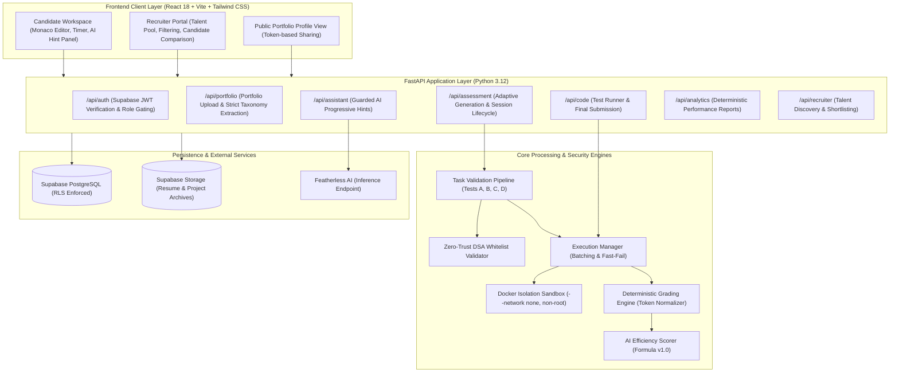

# VERITY — System Architecture & Component Specification

**Team:** Gate code (`HFT26-TEAM-75`)  
**Project:** Portfolio-Driven Adaptive Coding & Technical Assessment Platform  
**Architecture Version:** v2.0 (Hackathon Release)

---

## 1. High-Level Architecture Overview

VERITY is built on a modern, asynchronous full-stack architecture designed for strict candidate data isolation, zero-trust AI question generation, defense-in-depth container sandboxing, and deterministic grading without LLM evaluation.

---

## 2. Core Architectural Subsystems

### 2.1 Candidate Portfolio Intake Subsystem
- **Endpoints:** `POST /api/portfolio/upload`, `GET /api/portfolio/me`
- **Features:** Ingests candidate GitHub URLs, programming languages, frameworks, claimed solved DSA topics, and preferred domain.
- **Canonical Taxonomy:** Normalizes 18 DSA categories (Arrays, Linked Lists, Trees, Graphs, DP, Sliding Window, etc.).

### 2.2 Task Validation & Generation Pipeline Subsystem
- **Endpoints:** `POST /api/assessment/generate`
- **Inference Engine:** Featherless AI with prompt calibration grounded in portfolio data.
- **Fail-Safe Synthesizer:** If Featherless AI times out or fails, deterministic synthesizer generates validated, grounded coding problems.
- **Task Lifecycle:** `GENERATED` -> `VALIDATING` -> `VALIDATED` (or `REJECTED`). Unvalidated tasks are never delivered to candidates.

### 2.3 Defense-in-Depth Docker Sandbox Subsystem
- **Execution Engine:** Isolated containers for Python, C++, and Java.
- **Zero Host Access:** Containers run with `--network none`, `--cap-drop ALL`, `--security-opt no-new-privileges`, `--user 1001:1001`, `--read-only`, and tmpfs `/tmp:rw,size=32m,noexec,nosuid`.
- **Resource Constraints:** Hard CPU quota (0.5 cores), memory ceiling (256MB), and process ceiling (`--pids-limit 64`).

### 2.4 Deterministic Grading Subsystem
- **Non-LLM Guarantee:** Automated tests are graded strictly through exact token-normalized output comparison.
- **Test Confidentiality:** Hidden test cases and reference solutions are stored server-side only and never serialized to candidate HTTP responses.

### 2.5 Guarded AI Assistant Subsystem
- **Endpoints:** `POST /api/assistant/hint`
- **Progression Bounds:** Enforces strict sequential 3-level progression (Level 1 Conceptual, Level 2 Strategy, Level 3 Implementation).
- **Leakage Prevention:** Solution redaction heuristics prevent leaking complete code or hidden test cases.
- **Strict Tier Gating:** Completely disabled on Novice/Easy tier assessments with HTTP `403 AI_ASSISTANT_DISABLED_FOR_TIER`.

### 2.6 Recruiter Talent Discovery Subsystem
- **Endpoints:** `GET /api/recruiter/candidates`, `POST /api/recruiter/shortlist`, `POST /api/recruiter/compare`
- **Privacy Enforcement:** Excludes private student profiles; allows recruiters to filter talent by domain, language, coding score, AI efficiency score, and compare up to 4 candidates side-by-side.
